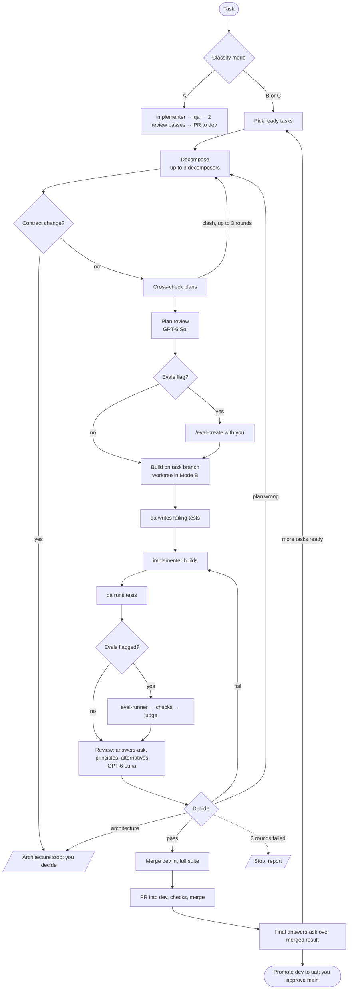
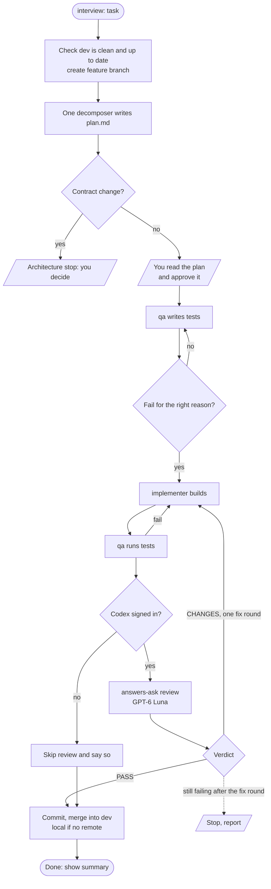

# Full loop vs interview-mode loop

Companion to [multi-agent-setup.md](multi-agent-setup.md) and [multi-agent-diagrams.md](multi-agent-diagrams.md).

## 1. Full loop

## 2. Interview-mode loop

## What interview mode drops and keeps

| Dropped | Kept |
| --- | --- |
| Mode classification, cross-check, planner steps | Architecture stop rule |
| Evals, wild-card, calibration | You read and approve the plan |
| `principles` and `alternatives` passes, plan review (Sol) | Tests first, confirmed failing for the right reason |
| Up to 3 decomposers, 3 fix rounds | One `answers-ask` review pass, one fix round |
| Parallel worktrees | Branch flow: feature branch, merge into `dev` |
