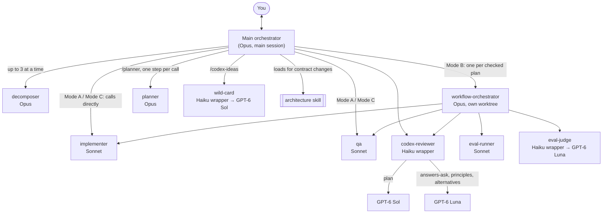
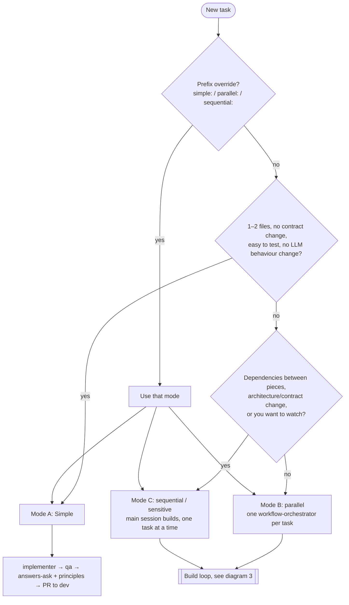
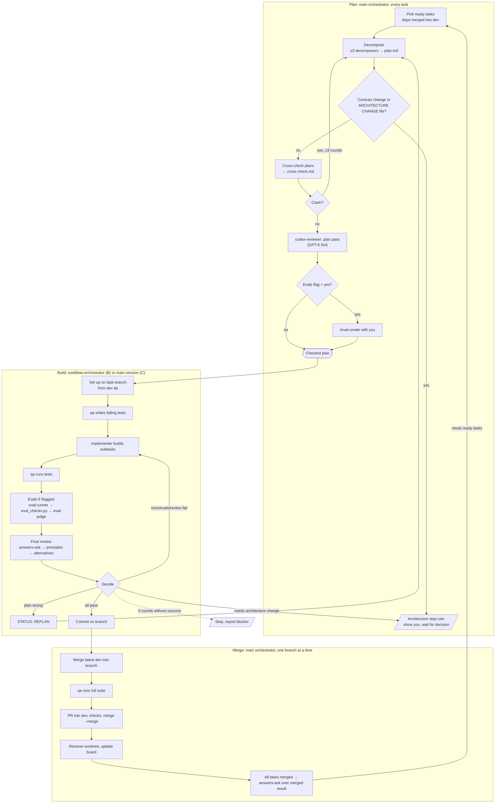
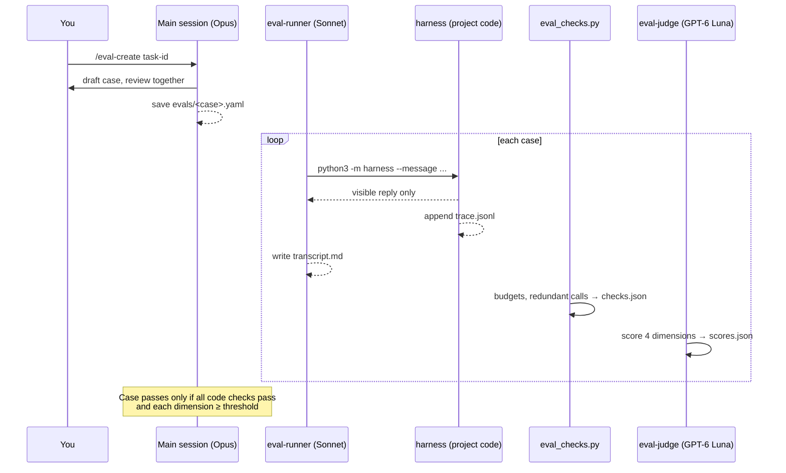
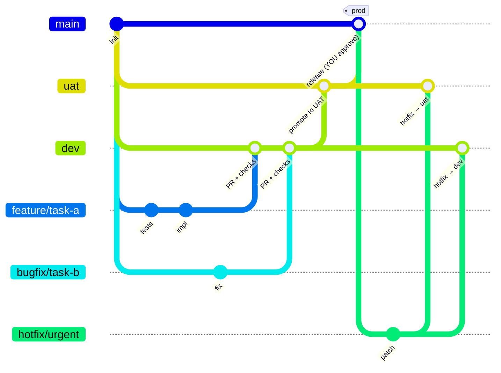
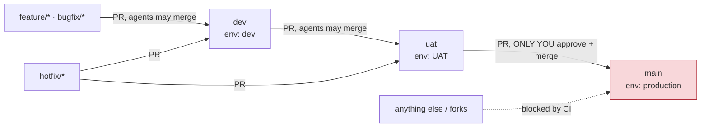
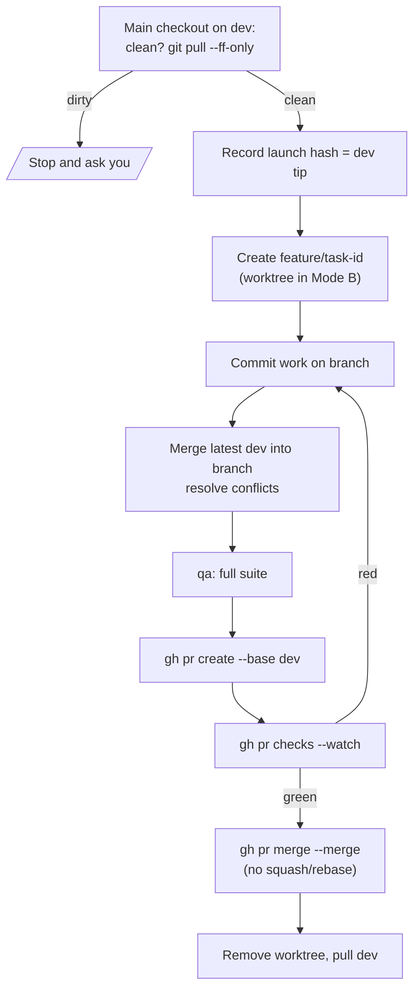

# Multi-agent workflow: diagrams

> **Historical spec.** This describes the first version of the workflow, copied into each project, with Modes A, B and C. The live rules are [CLAUDE.md](../CLAUDE.md) and [.claude/workflow/loop.md](../.claude/workflow/loop.md): the workflow lives only in this workspace root, the modes are Simple, Parallel and Sequential, commits are capped at 30 lines and reviewed one at a time, and each PR gets a full `pr` review.

Companion to [multi-agent-setup.md](multi-agent-setup.md).

## 1. Roles and who calls whom

## 2. Routing: which mode?

## 3. The build loop

## 4. Planner and `/build` (new product or large feature)

```mermaid
flowchart LR
    S1["1 Research +<br/>user stories"] --> S2["2 Alternatives<br/>+ falsifiable claims"]
    S2 --> S3["3 Test claims<br/>with real code"]
    S3 --> S4["4 New alternative<br/>from what failed"]
    S4 --> S5a["5 Draft solution<br/>+ flow diagrams"]
    S5a --> S5b["Refine with you<br/>05-decisions.md"]
    S5b --> S5c["5 Finalize<br/>05-solution.md"]
    S5c --> S6["6 PRD<br/>06-prd.md"]
    S6 --> BUILD["/build: board of tasks<br/>+ dependencies"]
    BUILD --> LOOP[[Build loop, JIT decomposition]]
    S1 -.->|"you approve each step;<br/>progress.md allows resume"| S2
```

## 5. Evals

## 6. GitHub branching strategy

### Allowed PR directions (enforced by `branch-order` CI)

### Per-task git lifecycle

