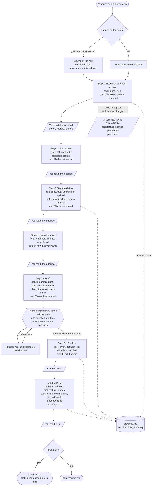
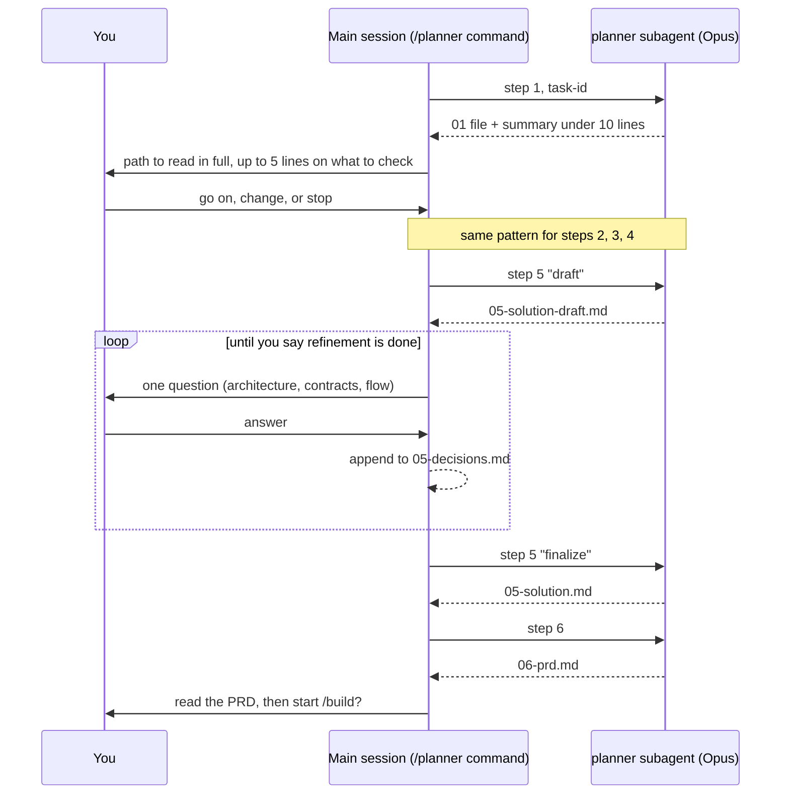
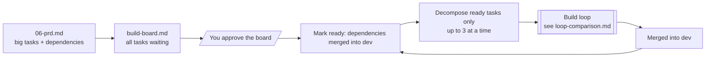

# Planning workflow (`/planner`)

> **Historical spec.** This describes the first version of the workflow, copied into each project, with Modes A, B and C. The live rules are [CLAUDE.md](../CLAUDE.md) and [.claude/workflow/loop.md](../.claude/workflow/loop.md): the workflow lives only in this workspace root, the modes are Simple, Parallel and Sequential, commits are capped at 30 lines and reviewed one at a time, and each PR gets a full `pr` review.

Companion to [multi-agent-setup.md](multi-agent-setup.md) (sections 7.15 and 7.16). Files live in `.claude/runs/<task-id>/planner/`.

## 1. The six steps, with outputs and your checkpoints

## 2. Who does what in each step

## 3. How it connects to the build

## Notes

- **Why a subagent can't do step 5 alone:** it can't talk to you, so the refinement runs in the main session. Only the planner writes step files; the main session writes only `05-decisions.md` and `progress.md`.
- **Crash safety:** every step's output is a file, and `progress.md` records the last finished step, so `/planner <task-id>` resumes where it stopped.
- **Interview mode:** the planner is cut entirely. Use it only for a large feature, not for a 90-minute task.
